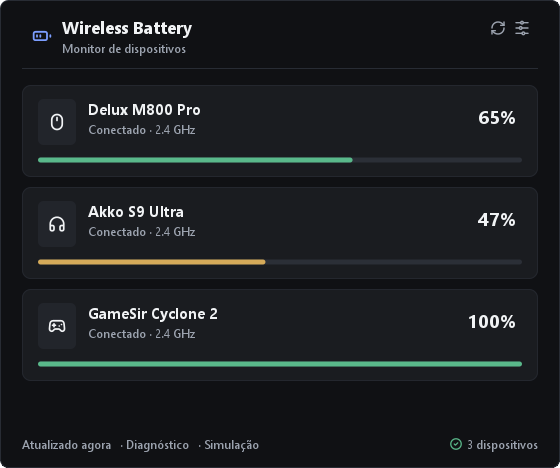

[Português (pt-BR)](README.pt-BR.md)

# Wireless Battery Monitor · Java Edition

**Wireless Battery Monitor** displays the battery level of your wireless peripherals in a compact desktop window, in the Windows system tray, and directly next to the Windows clock.

- **Latest stable release:** [`v1.2.0`](https://github.com/kybiy/Wireless-Device-Battery-Monitor/releases)
- **Active development:** `v1.3.0` robustness and community features are in progress on branch `feat/robustness-v1.3.0` (features marked *(v1.3.0 WIP)* below are present on this branch and awaiting full physical validation before release).



---

## Features

- **USB HID + Native Windows Bluetooth Monitoring:** Automatically detects supported 2.4 GHz USB receivers and **QCY T13 ANC** Bluetooth earbuds via passive Windows PnP SetupAPI properties (`DEVPKEY_Bluetooth_Battery` / `PKEY_Devices_BatteryLife` / `DEVPKEY_Bluetooth_IsConnected`), preserving last known readings when devices go asleep.
- **Automatic Headset Selection:** Unifies the audio category into a single card and taskbar indicator (keeping a clean 3-indicator layout: mouse, active headset, controller). When both **Akko S9 Ultra** and **QCY T13 ANC** are connected, inspects the active Windows default audio output via Core Audio (`MMDevice` COM API) to display the headset in use.
- **Native Win32 Taskbar Widget (`Win+D` Compatible):** Anchors horizontally next to the Windows clock using a native child window (`WS_CHILD | WS_CLIPSIBLINGS`, `WS_EX_LAYERED | WS_EX_NOACTIVATE`) parented to `Shell_TrayWnd` and rendered via `UpdateLayeredWindow`. Stays visible on **`Win+D` (Show Desktop)** and `Alt+Tab`, never steals focus, does not overlap fullscreen games, and automatically re-attaches if `explorer.exe` restarts.
- **System Tray Integration (`SystemTray`):** Individual crisp icons per device with live tooltips and a full context menu; works alone or alongside the taskbar widget.
- **Configurable Battery Alerts *(v1.3.0 WIP)*:** Per-device low and critical battery threshold alerts with optional suppression while charging.
- **Local Battery History, Discharge Graph, CSV Export & Autonomy Estimate *(v1.3.0 WIP)*:** Stores real and simulated samples separately in local TSV files (`%USERPROFILE%\.wireless-battery-java\history\`, configurable 7 / 30 / 90-day retention), plots discharge trends, exports CSV, and provides a conservative remaining-autonomy estimate once at least 3 real samples spanning ≥ 30 minutes and ≥ 3% net discharge are recorded.
- **Isolated Simulation Mode:** Test UI layouts, taskbar styling, alerts, and Akko/QCY headset switching safely without physical hardware.
- **Internationalization (`pt-BR` / `en-US`) *(v1.3.0 WIP)*:** Switch between System default, Brazilian Portuguese, and US English in Settings.
- **Read-Only HID Safety Mode & GameSir Notice *(v1.3.0 WIP)*:** Optional `Read-Only HID Mode` blocks experimental Output Report writes (`GameSir Cyclone 2`), which is also guarded by a first-use safety notice and an explicit per-device toggle.
- **Eco Mode & Idle Memory Optimizations:** Cached SVG vector icons (`SVG_CACHE`), paused progress-bar animations when hidden, bounded log history (`400` entries), and **Eco Mode** *(v1.3.0 WIP)* which automatically slows background polling (`max(min(60, base*2), 30)` seconds) when the main window is hidden.
- **Anonymized Diagnostic ZIP Export *(v1.3.0 WIP)*:** Generates a local ZIP bundle (`diagnostic-summary.txt`, `driver-states.txt`, `hid-interfaces.txt`, sanitized `settings.properties`, and logs) with automatic redaction of usernames, hostnames, emails, Bluetooth MACs, HID serial/container paths, and tokens—never uploaded automatically.
- **Optional GitHub Release Update Checker *(v1.3.0 WIP)*:** Queries public GitHub Releases on demand or at most once every 24 hours when opted in, with zero telemetry or auth tokens.

---

## Supported Devices & Connection Types

**This edition strictly supports the four devices listed below:**

| Device | Type | Connection | Protocol / Notes | Validation Status |
| --- | --- | --- | --- | --- |
| **Delux M800 Pro PAW3395** | Wireless Mouse | 2.4 GHz USB Dongle (`0x248A:0x5B2F`) & USB Cable (`0x5B2E`) | USB HID Feature Report `0x0C` (`IF 1`, `0xFF00:0x0001`) | Validated on Windows 11 (`v1.1.1+` percentage reading confirmed; charging/100% check in `v1.3.0` checklist) |
| **Akko Verge S9 / S9 Ultra** | Wireless Headset | 2.4 GHz USB Dongle (`0x36EB:0x1087`) | USB HID Output Report `0x02` cmd `0x12` with CRC-16 `0x8005` (`IF 3`, `0x008C:0x0001`) | Validated on Windows 11 |
| **QCY T13 ANC (`QCY-T13 ANC`)** | Bluetooth Earbuds | Bluetooth (Windows Native APIs) | Passive Windows PnP properties (`DEVPKEY_Bluetooth_Battery` / `PKEY_Devices_BatteryLife`) — no RFCOMM/GATT connections | Validated on Windows 11 (`20%` real reading confirmed by user matching Windows) |
| **GameSir Cyclone 2** | Wireless Controller | 2.4 GHz USB Dongle (`0x3537:0x100B` / `0x0575` idle) & USB Cable (`0x1053`), **XInput mode** | HID Output Report `0x0F 0x03` / Input `0x12` (`0xFFF0:0x0040`). Bytes `[2..63]` always `0x00` so LED register `0x20` is never written | Experimental (requires physical validation across firmware revisions; blocked in Read-Only HID Mode) |

> [!NOTE]
> Other devices, firmware revisions, or untested Bluetooth headsets are not declared physically compatible and may not expose battery levels via Windows APIs.

---

## Windows Compatibility

| Platform | Status | Scope & Notes |
| --- | --- | --- |
| **Windows 11 x64** | **Validated** | Primary target. Delux M800 Pro, Akko Verge S9 Ultra, GameSir Cyclone 2, QCY T13 ANC (`20%` confirmed), `Shell_TrayWnd` taskbar widget (`Win+D`), and in-place MSI upgrades tested on Windows 11 x64. |
| **Windows 10 x64** | **Experimental / Partially Validated** | `Shell_TrayWnd` taskbar attachment, SetupAPI/MMDevice/Core Audio, and automated JUnit tests pass on Windows 10 Pro x64, but full real-hardware peripheral validation was performed on Windows 11 x64. |
| **Windows ARM64, Linux, macOS** | **Not Supported** | Out of scope (relies on Windows x64 Win32, SetupAPI, Core Audio, and WiX/jpackage tooling). |

---

## Download (`v1.2.0` Stable Release)

Download Windows x64 packages from [GitHub Releases](https://github.com/kybiy/Wireless-Device-Battery-Monitor/releases):

| Asset | Description |
| --- | --- |
| `WirelessBattery-1.2.0.exe` | **Recommended.** Per-user Windows x64 installer with bundled Java runtime. Installs to `%LOCALAPPDATA%\WirelessBattery\` without Administrator privileges and upgrades prior versions in place. |
| `WirelessBattery-1.2.0-portable-win-x64.zip` | Portable Windows x64 archive with bundled Java runtime. Extract and run `WirelessBattery\WirelessBattery.exe`. |
| `SHA256SUMS.txt` *(203 bytes)* | SHA-256 checksums for verifying the installer and portable ZIP. |

### Checksum Verification & SmartScreen

Verify downloaded files in PowerShell and compare against `SHA256SUMS.txt`:

```powershell
Get-FileHash .\WirelessBattery-1.2.0.exe -Algorithm SHA256
Get-FileHash .\WirelessBattery-1.2.0-portable-win-x64.zip -Algorithm SHA256
```

Unsigned open-source binaries trigger a **Windows SmartScreen** prompt. Always confirm the official GitHub Release URL and SHA-256 hash before clicking **More info** → **Run anyway**. Never disable SmartScreen or Windows Defender. See [docs/CODE_SIGNING_AND_SMARTSCREEN.md](docs/CODE_SIGNING_AND_SMARTSCREEN.md) for details.

---

## Installation, Upgrade & Uninstallation

1. **Fresh Install:** Run `WirelessBattery-1.2.0.exe` (or extract the portable ZIP). Connect your 2.4 GHz USB dongle(s) or pair/connect **QCY-T13 ANC** in Windows Bluetooth Settings. Put the GameSir Cyclone 2 in **XInput mode**.
2. **In-Place Upgrade (`v1.0.0` / `v1.1.x` → `v1.2.0+`):** Run the new `.exe` installer directly without uninstalling first.
   - Uses fixed MSI `UpgradeCode` `{7C2F4B5E-3D9A-4E8C-91F2-8A6B4D2E1C90}` (`--win-upgrade-uuid 7c2f4b5e-3d9a-4e8c-91f2-8a6b4d2e1c90`).
   - `CloseHelper` gracefully closes only the installed running instance scoped to `[INSTALLDIR]` (leaving portable copies untouched).
   - Preserves `%USERPROFILE%\.wireless-battery-java\settings.properties`, shortcuts, and `HKCU\Software\Microsoft\Windows\CurrentVersion\Run` autostart preferences.
3. **Uninstall:** Remove via Windows **Settings → Apps → Installed apps → WirelessBattery**. Preferences/history under `%USERPROFILE%\.wireless-battery-java\` remain intact unless deleted manually.

---

## Building, Testing & Packaging

### Build & Verify (JDK 17+ & Maven)
`maven.compiler.release` is set to `17`. Run from the repository root:

```powershell
mvn clean verify
mvn clean package
mvn exec:java
```

`mvn clean verify` compiles with `-Xlint:all,-serial,-processing`, runs the full JUnit 5 test suite, and enforces **SpotBugs** static analysis (`spotbugs-maven-plugin`).

### Windows x64 Installer & Portable ZIP (JDK 25 + WiX Toolset 3.14+)
After `mvn clean package`, run `scripts/package-windows.ps1` with JDK 25 (`jpackage`) and WiX Toolset 3.14+:

```powershell
powershell -NoProfile -ExecutionPolicy Bypass -File .\scripts\package-windows.ps1 `
  -Jdk "path\to\jdk-25" `
  -Wix "path\to\wix314"
```

This compiles `packaging/wix/CloseHelper.cs`, applies custom WiX templates (`packaging/wix/`), preserves `--win-upgrade-uuid 7c2f4b5e-3d9a-4e8c-91f2-8a6b4d2e1c90`, copies `LICENSE`, `THIRD-PARTY-NOTICES.md`, and `docs/licenses/*` into `licenses/`, and generates the `.exe` installer, portable `.zip`, and `SHA256SUMS.txt`.

### Measured Memory Footprint Conditions
In a `v1.2.0` probe measured under `-XX:+UseSerialGC -Xms8m -Xmx64m` without a physical Bluetooth radio:
- **~61 MB Working Set / ~3.4 MB used heap** during a 50-cycle background poll loop
- **~92 MB Working Set / ~7.5 MB used heap** with the Swing main window open

*(Real memory usage varies with JVM ergonomics, Windows DPI scaling, and active UI dialogs.)*

---

## Known Limitations

- **Hardware-specific scope:** Only the four listed devices are implemented.
- **Bluetooth reporting dependency:** QCY T13 ANC readings depend on Windows PnP battery properties reported by the Windows Bluetooth stack.
- **Unsigned binaries:** SmartScreen warns on unsigned `.exe` downloads until a trusted OSS signing pipeline is adopted ([CODE_SIGNING_AND_SMARTSCREEN.md](docs/CODE_SIGNING_AND_SMARTSCREEN.md)).
- **Windows x64 only:** No Linux, macOS, or Windows ARM64 support.

---

## Licenses, Credits & Governance

This project is a Java recode inspired by **krisgfx9/Wireless-Device-Battery-Monitor** (the original C++ *BatteryHub* by **krisgfx9**). All credit for creating the original project belongs to its author. Note that the original `krisgfx9/Wireless-Device-Battery-Monitor` repository URL currently returns HTTP 404; historical archive available via [ferloom/Wireless-Device-Battery-Monitor](https://github.com/ferloom/Wireless-Device-Battery-Monitor).

Additional architectural and protocol references:
- [joaoarebalo/Wireless-Device-Battery-Monitor-Fallen](https://github.com/joaoarebalo/Wireless-Device-Battery-Monitor-Fallen) (GPL-3.0)
- [xb-bx/m800-pro-driver](https://github.com/xb-bx/m800-pro-driver) (GPL-2.0)
- [vdemonchy/cyclone2-linux](https://github.com/vdemonchy/cyclone2-linux) (GPL-3.0)
- [pedrosegato/gamesir-reverse-engineering](https://github.com/pedrosegato/gamesir-reverse-engineering) (MIT)

- **License:** [GNU General Public License v3.0 (LICENSE)](LICENSE)
- **Third-Party Notices & Bundled Libraries:** [THIRD-PARTY-NOTICES.md](THIRD-PARTY-NOTICES.md) & [docs/licenses/REDISTRIBUICAO.md](docs/licenses/REDISTRIBUICAO.md)
- **Contributing:** [CONTRIBUTING.md](CONTRIBUTING.md)
- **Security & HID Safety Policy:** [SECURITY.md](SECURITY.md)
- **Physical Validation Checklist (v1.3.0):** [docs/PHYSICAL_VALIDATION_CHECKLIST_v1.3.0.md](docs/PHYSICAL_VALIDATION_CHECKLIST_v1.3.0.md)
