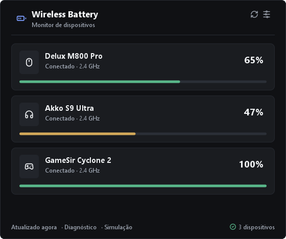

[English (en-US)](README.md)

# Wireless Battery Monitor · Java Edition

O **Wireless Battery Monitor** mostra a carga dos seus periféricos sem fio na janela principal, na bandeja do sistema e diretamente ao lado do relógio do Windows.

- **Última versão estável:** [`v1.2.0`](https://github.com/kybiy/Wireless-Device-Battery-Monitor/releases)
- **Desenvolvimento ativo:** os recursos de robustez e comunidade da `v1.3.0` estão em andamento na branch `feat/robustness-v1.3.0` (itens marcados como *(v1.3.0 em desenvolvimento)* abaixo já existem nesta branch e aguardam validação física completa antes do lançamento).



---

## Funcionalidades

- **Monitoramento USB HID + Bluetooth nativo do Windows:** detecta automaticamente os receptores USB 2,4 GHz suportados e o fone Bluetooth **QCY T13 ANC** por meio de propriedades passivas PnP/SetupAPI do Windows (`DEVPKEY_Bluetooth_Battery` / `PKEY_Devices_BatteryLife` / `DEVPKEY_Bluetooth_IsConnected`), preservando a última leitura conhecida em repouso.
- **Seleção automática de fones (Akko S9 Ultra / QCY T13 ANC):** unifica a categoria de áudio em um único cartão e indicador na barra de tarefas (mantendo os três indicadores: mouse, fone ativo e controle). Quando ambos os fones estão conectados, consulta a saída de áudio padrão do Windows via Core Audio (`MMDevice` COM API) para exibir o fone efetivamente em uso.
- **Widget nativo Win32 na barra de tarefas (compatível com `Win+D`):** exibe os indicadores ao lado do relógio usando uma janela filha nativa (`WS_CHILD | WS_CLIPSIBLINGS`, `WS_EX_LAYERED | WS_EX_NOACTIVATE`) anexada à `Shell_TrayWnd` e renderizada via `UpdateLayeredWindow`. Permanece visível com **`Win+D` (*Mostrar área de trabalho*)** e `Alt+Tab`, não rouba foco, não sobrepõe jogos em tela cheia e se recupera automaticamente se o `explorer.exe` for reiniciado.
- **Integração com a bandeja do sistema (`SystemTray`):** ícones individuais nítidos por dispositivo com tooltips atualizados e menu de contexto completo, podendo operar isoladamente ou em conjunto com o widget da barra de tarefas.
- **Alertas configuráveis de bateria *(v1.3.0 em desenvolvimento)*:** limites de bateria baixa e crítica configuráveis por dispositivo, com supressão opcional enquanto estiver carregando.
- **Histórico local, gráfico de descarga, exportação CSV e estimativa conservadora de autonomia *(v1.3.0 em desenvolvimento)*:** grava amostras reais e simuladas separadamente em arquivos TSV locais (`%USERPROFILE%\.wireless-battery-java\history\`, retenção configurável de 7, 30 ou 90 dias), exibe gráfico de descarga, exporta CSV e estima a autonomia restante somente com base conservadora (mínimo de 3 amostras reais contíguas, ≥ 30 minutos e ≥ 3% de descarga líquida).
- **Modo de simulação isolado:** teste layouts, barra de tarefas, alertas e alternância Akko/QCY sem precisar de hardware físico conectado.
- **Internacionalização (`pt-BR` / `en-US`) *(v1.3.0 em desenvolvimento)*:** seleção de idioma em Configurações (Sistema, Português do Brasil ou Inglês dos EUA).
- **Modo Somente-Leitura HID e aviso de segurança do GameSir *(v1.3.0 em desenvolvimento)*:** o modo opcional `Read-Only HID Mode` bloqueia gravações experimentais de Output Report (`GameSir Cyclone 2`), que também conta com aviso de segurança no primeiro uso e opção dedicada por dispositivo.
- **Modo Eco e otimizações de memória:** cache de ícones SVG (`SVG_CACHE`), pausa automática de animações quando oculto, limite de logs (`400` entradas) e **Modo Eco** *(v1.3.0 em desenvolvimento)* que reduz a frequência de consulta em segundo plano (`max(min(60, base*2), 30)` segundos) quando a janela está oculta.
- **Exportação de diagnóstico ZIP anonimizado *(v1.3.0 em desenvolvimento)*:** gera um pacote ZIP local (`diagnostic-summary.txt`, `driver-states.txt`, `hid-interfaces.txt`, `settings.properties` sanitizado e logs) ocultando automaticamente usuário, hostname, e-mails, MACs Bluetooth, seriais/caminhos HID e tokens — nunca enviado automaticamente pela rede.
- **Verificador opcional de atualizações no GitHub Releases *(v1.3.0 em desenvolvimento)*:** consulta somente a API pública do GitHub Releases sob demanda ou no máximo a cada 24 horas quando ativado pelo usuário, sem telemetria ou tokens.

---

## Dispositivos suportados e tipos de conexão

**Esta edição Java oferece suporte exclusivamente aos quatro dispositivos abaixo:**

| Dispositivo | Tipo | Conexão | Protocolo / Observações | Estado da validação |
| --- | --- | --- | --- | --- |
| **Delux M800 Pro PAW3395** | Mouse sem fio | Dongle USB 2,4 GHz (`0x248A:0x5B2F`) e cabo USB (`0x5B2E`) | USB HID Feature Report `0x0C` (`IF 1`, `0xFF00:0x0001`) | Validado no Windows 11 (percentual real confirmado a partir da `v1.1.1`; carregamento/100% no checklist da `v1.3.0`) |
| **Akko Verge S9 / S9 Ultra** | Headset sem fio | Dongle USB 2,4 GHz (`0x36EB:0x1087`) | USB HID Output Report `0x02` cmd `0x12` com CRC-16 `0x8005` (`IF 3`, `0x008C:0x0001`) | Validado no Windows 11 |
| **QCY T13 ANC (`QCY-T13 ANC`)** | Fone Bluetooth | Bluetooth (APIs nativas do Windows) | Leitura passiva PnP do Windows (`DEVPKEY_Bluetooth_Battery` / `PKEY_Devices_BatteryLife`) — sem conexões RFCOMM/GATT | Validado no Windows 11 (`20%` reais confirmados pelo usuário idênticos ao Windows) |
| **GameSir Cyclone 2** | Controle sem fio | Dongle USB 2,4 GHz (`0x3537:0x100B` / `0x0575` ocioso) e cabo USB (`0x1053`), **modo XInput** | HID Output Report `0x0F 0x03` / Input `0x12` (`0xFFF0:0x0040`). Bytes `[2..63]` sempre `0x00` para nunca escrever no seletor LED `0x20` | Experimental (requer validação física em diferentes revisões de firmware; bloqueado no Modo Somente-Leitura HID) |

> [!NOTE]
> Outros modelos, revisões de firmware ou fones Bluetooth não testados não são declarados fisicamente compatíveis e podem não expor nível de bateria via Windows.

---

## Compatibilidade com Windows

| Plataforma | Estado | Escopo e observações |
| --- | --- | --- |
| **Windows 11 x64** | **Validado** | Alvo principal. Delux M800 Pro, Akko Verge S9 Ultra, GameSir Cyclone 2, QCY T13 ANC (`20%` confirmados), widget nativo `Shell_TrayWnd` (`Win+D`) e atualização in-place MSI validados no Windows 11 x64. |
| **Windows 10 x64** | **Experimental / Parcialmente validado** | Integração `Shell_TrayWnd`, SetupAPI/MMDevice/Core Audio e testes automatizados JUnit passam no Windows 10 Pro x64, porém a validação completa com periféricos físicos reais foi realizada no Windows 11 x64. |
| **Windows ARM64, Linux, macOS** | **Não suportado** | Fora de escopo (depende de APIs nativas Windows x64, SetupAPI, Core Audio e empacotamento WiX/jpackage). |

---

## Download (`v1.2.0` estável)

Baixe os pacotes para **Windows x64** em [GitHub Releases](https://github.com/kybiy/Wireless-Device-Battery-Monitor/releases):

| Arquivo | Como usar |
| --- | --- |
| `WirelessBattery-1.2.0.exe` | **Recomendado.** Instalador por usuário para Windows x64 com runtime Java embutido. Instala em `%LOCALAPPDATA%\WirelessBattery\` sem exigir privilégios de Administrador e atualiza versões anteriores no local. |
| `WirelessBattery-1.2.0-portable-win-x64.zip` | Pacote portátil para Windows x64 com runtime Java embutido. Extraia a pasta e execute `WirelessBattery\WirelessBattery.exe`. |
| `SHA256SUMS.txt` *(203 bytes)* | Somas SHA-256 para verificação de integridade do instalador e do ZIP portátil. |

### Verificação de integridade e Windows SmartScreen

No PowerShell, confira o hash SHA-256 dos arquivos baixados com `SHA256SUMS.txt`:

```powershell
Get-FileHash .\WirelessBattery-1.2.0.exe -Algorithm SHA256
Get-FileHash .\WirelessBattery-1.2.0-portable-win-x64.zip -Algorithm SHA256
```

Executáveis open-source sem assinatura digital comercial exibem aviso do **Windows SmartScreen**. Confira a URL oficial da Release e o hash SHA-256 antes de clicar em **Mais informações** → **Executar assim mesmo**. Nunca desative o SmartScreen ou o Windows Defender. Veja detalhes em [docs/CODE_SIGNING_AND_SMARTSCREEN.md](docs/CODE_SIGNING_AND_SMARTSCREEN.md).

---

## Instalação, atualização e desinstalação

1. **Instalação nova:** Execute `WirelessBattery-1.2.0.exe` (ou extraia o ZIP portátil). Conecte o(s) dongle(s) USB 2,4 GHz ou pareie/conecte o **QCY-T13 ANC** via Bluetooth no Windows. No GameSir Cyclone 2, selecione o **modo XInput**.
2. **Atualização automática no local (`v1.0.0` / `v1.1.x` → `v1.2.0+`):** Execute o novo instalador `.exe` diretamente, sem desinstalar a versão anterior:
   - Mantém o `UpgradeCode` fixo `{7C2F4B5E-3D9A-4E8C-91F2-8A6B4D2E1C90}` (`--win-upgrade-uuid 7c2f4b5e-3d9a-4e8c-91f2-8a6b4d2e1c90`).
   - O `CloseHelper` encerra com segurança apenas a instância instalada em `[INSTALLDIR]` (sem afetar cópias portáteis).
   - Preserva `%USERPROFILE%\.wireless-battery-java\settings.properties`, atalhos e preferência de inicialização em `HKCU\Software\Microsoft\Windows\CurrentVersion\Run`.
3. **Desinstalação:** Remova em **Configurações do Windows → Aplicativos → Aplicativos instalados → WirelessBattery**. Preferências e histórico em `%USERPROFILE%\.wireless-battery-java\` são preservados até remoção manual.

---

## Compilação, testes e empacotamento

### Compilar, verificar e executar (JDK 17+ e Maven)
`maven.compiler.release` está configurado como `17`. Execute na raiz do repositório:

```powershell
mvn clean verify
mvn clean package
mvn exec:java
```

`mvn clean verify` compila com `-Xlint:all,-serial,-processing`, executa toda a suíte JUnit 5 e aplica análise estática **SpotBugs** (`spotbugs-maven-plugin`).

### Empacotar distribuição Windows x64 (JDK 25 + WiX Toolset 3.14+)
Após `mvn clean package`, execute `scripts/package-windows.ps1` com JDK 25 (`jpackage`) e WiX Toolset 3.14+:

```powershell
powershell -NoProfile -ExecutionPolicy Bypass -File .\scripts\package-windows.ps1 `
  -Jdk "caminho\para\jdk-25" `
  -Wix "caminho\para\wix314"
```

O script compila `packaging/wix/CloseHelper.cs`, aplica os templates WiX (`packaging/wix/`), mantém `--win-upgrade-uuid 7c2f4b5e-3d9a-4e8c-91f2-8a6b4d2e1c90`, copia `LICENSE`, `THIRD-PARTY-NOTICES.md` e `docs/licenses/*` para `licenses/` e gera o instalador `.exe`, o `.zip` portátil e `SHA256SUMS.txt`.

### Condições de medição de consumo de memória
Em medição realizada na `v1.2.0` sob `-XX:+UseSerialGC -Xms8m -Xmx64m` sem rádio Bluetooth físico conectado:
- **~61 MB de Working Set / ~3,4 MB de heap usado** em loop de 50 ciclos de consulta
- **~92 MB de Working Set / ~7,5 MB de heap usado** com a janela Swing aberta

*(O consumo real varia conforme ergonomia da JVM, escala de DPI do Windows e diálogos abertos.)*

---

## Limitações conhecidas

- **Escopo específico de hardware:** apenas os quatro dispositivos listados são implementados.
- **Dependência da pilha Bluetooth do Windows:** a leitura do QCY T13 ANC depende das propriedades de bateria expostas pelo Windows.
- **Binários sem assinatura comercial:** o SmartScreen exibe aviso até que uma assinatura OSS confiável seja adotada ([CODE_SIGNING_AND_SMARTSCREEN.md](docs/CODE_SIGNING_AND_SMARTSCREEN.md)).
- **Somente Windows x64:** sem suporte para Linux, macOS ou Windows ARM64.

---

## Licenças, créditos e governança

Este projeto é uma reimplementação em Java inspirada no **krisgfx9/Wireless-Device-Battery-Monitor** (o *BatteryHub* original em C++ por **krisgfx9**). Todos os créditos pela criação do projeto original pertencem ao seu respectivo autor. A URL original `krisgfx9/Wireless-Device-Battery-Monitor` atualmente retorna HTTP 404; um espelho/arquivo histórico pode ser consultado em [ferloom/Wireless-Device-Battery-Monitor](https://github.com/ferloom/Wireless-Device-Battery-Monitor).

Referências técnicas e de protocolo adicionais:
- [joaoarebalo/Wireless-Device-Battery-Monitor-Fallen](https://github.com/joaoarebalo/Wireless-Device-Battery-Monitor-Fallen) (GPL-3.0)
- [xb-bx/m800-pro-driver](https://github.com/xb-bx/m800-pro-driver) (GPL-2.0)
- [vdemonchy/cyclone2-linux](https://github.com/vdemonchy/cyclone2-linux) (GPL-3.0)
- [pedrosegato/gamesir-reverse-engineering](https://github.com/pedrosegato/gamesir-reverse-engineering) (MIT)

- **Licença:** [GNU General Public License v3.0 (LICENSE)](LICENSE)
- **Avisos de terceiros e bibliotecas embutidas:** [THIRD-PARTY-NOTICES.md](THIRD-PARTY-NOTICES.md) e [docs/licenses/REDISTRIBUICAO.md](docs/licenses/REDISTRIBUICAO.md)
- **Como contribuir:** [CONTRIBUTING.md](CONTRIBUTING.md)
- **Política de segurança e segurança HID:** [SECURITY.md](SECURITY.md)
- **Checklist de validação física (v1.3.0):** [docs/PHYSICAL_VALIDATION_CHECKLIST_v1.3.0.md](docs/PHYSICAL_VALIDATION_CHECKLIST_v1.3.0.md)
